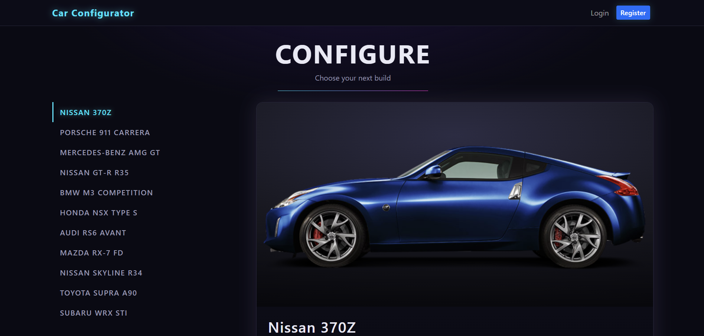
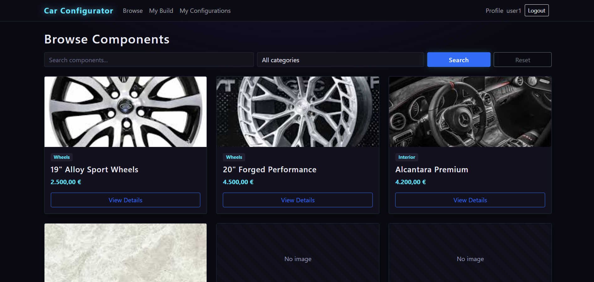
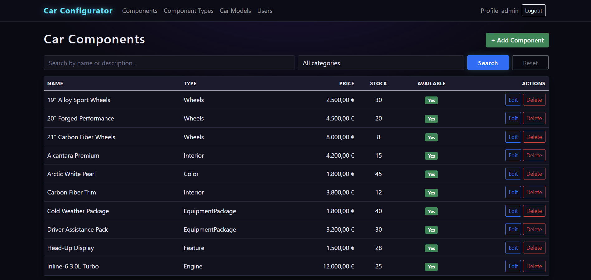
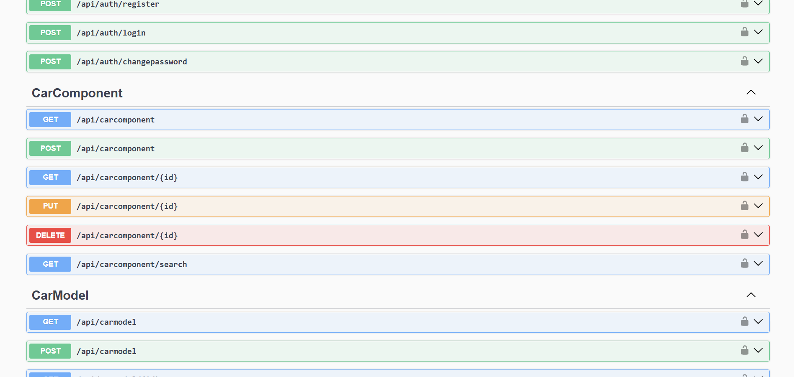

# Car Configurator

A car configuration application built with **C# / .NET 8**, made as a solo project for the Algebra University *Development of Web Applications* (DWA) course.

Users browse car models and components, build a configuration, and save it. The system rejects builds that contain incompatible components. Admins manage the catalog and users.

The solution has two front ends that share one business layer:

- **WebApp** – ASP.NET Core MVC website (cookie authentication)
- **WebAPI** – REST API (JWT bearer authentication, Swagger UI)

## Tech stack

- C#, .NET 8, ASP.NET Core MVC and Web API
- Entity Framework Core 8 with SQL Server (LocalDB by default)
- AutoMapper, DTOs, view models
- JWT bearer auth (API), cookie auth (web app), role-based authorization (`Admin`, `User`)
- Password hashing with PBKDF2 (100,000 iterations, per-user salt)

## Solution structure

| Project | Purpose |
|---|---|
| `CarConfigurator.Data` | EF Core context and entity models |
| `CarConfigurator.Business` | Services, DTOs, mapping profiles, security (password hashing, JWT) |
| `WebAPI` | REST controllers, exception-handling middleware, Swagger |
| `WebApp` | MVC controllers, views, view models, image upload |

## Screenshots

| Catalog | Configurator |
|---|---|
|  |  |

| Admin panel | Swagger UI |
|---|---|
|  |  |

## Features

- Registration, login, change password; roles `Admin` and `User`
- Catalog of car models and components with paging and search
- Configuration builder with component compatibility rules (incompatible pairs are rejected on save)
- Admin CRUD for car models, component types and components, including image upload (jpg, png, gif, webp, up to 5 MB)
- Admin view of all users and their saved configurations
- Global exception middleware that writes errors to a `Logs` table; log viewer page in the API (`/logs.html`)

## Running locally

**Requirements:** .NET 8 SDK and SQL Server LocalDB (installed with Visual Studio) or any SQL Server instance.

### 1. Create the database

Open `Database/CarConfigurator.sql` in SSMS (or Azure Data Studio). Use it to create the `CarConfigurator` database, the tables, and sample data: 11 car models, 19 components with compatibility rules, two demo accounts and one saved configuration.

### 2. Set the JWT signing key

The key is not stored in the repository. Set your own (at least 32 characters) with user secrets. The API refuses to start without it.

```bash
cd WebAPI
dotnet user-secrets set "Jwt:Key" "<your-random-key-at-least-32-chars>"
cd ../WebApp
dotnet user-secrets init
dotnet user-secrets set "Jwt:Key" "<your-random-key-at-least-32-chars>"
```

### 3. Run

```bash
dotnet run --project WebAPI    # http://localhost:5235  (Swagger UI: /swagger)
dotnet run --project WebApp    # http://localhost:5294
```

Or open `CarConfigurator.sln` in Visual Studio and start both projects.

### 4. Log in

The seed script creates two demo accounts. They are for local use only:

| Username | Password | Role |
|---|---|---|
| `admin` | `Admin123!` | Admin |
| `user1` | `User123!` | User |

New accounts registered on the website get the `User` role. To promote one:

```sql
UPDATE ApplicationUser SET Role = 'Admin' WHERE Username = 'your_username';
```

## API overview

All routes are under `/api`:

- `auth` – `register`, `login`, `changepassword`
- `carmodel`, `carcomponent` (also `search`), `componenttype` – CRUD
- `logs` – `get/{n}`, `count`

In Swagger, use **Authorize** and paste the token returned by `login`.
